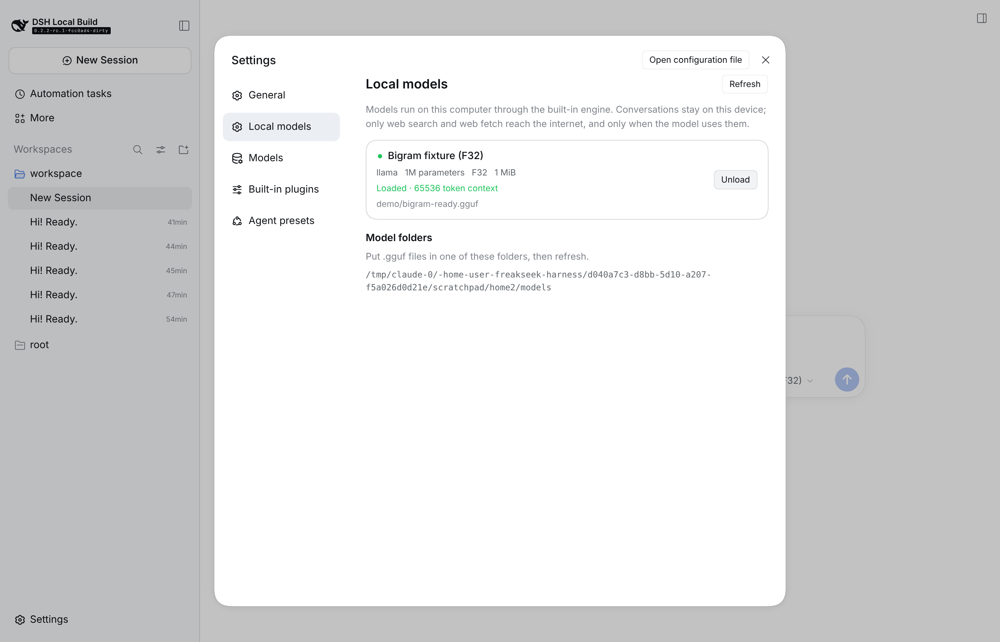
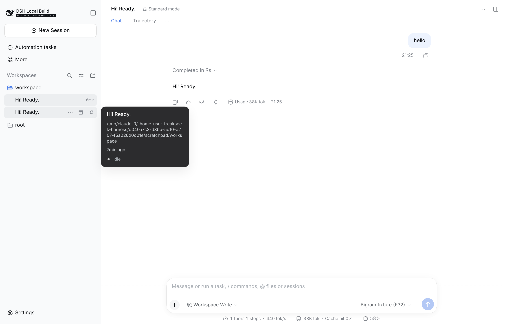
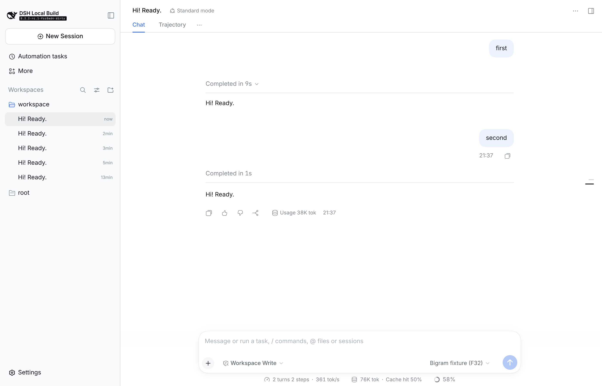

# FreakSeek

**FreakSeek** (Fast Rust Embodied AI Kernel) is a fork of [DeepSeek Harness](https://github.com/deepseek-ai/deepseek-harness) that runs GGUF models entirely on your own computer. An embedded Rust inference engine loads the model, renders its chat template, and streams tokens to the agent; FreakSeek has two surfaces: the **desktop app**, where you pick, load, and chat with local models, and the **CLI**, which runs tasks on them from a terminal. Neither needs an account, an API key, or a network connection, and FreakSeek ships no browser UI.

FreakSeek keeps the upstream **everything-is-a-plugin** architecture powered by [Cordis](https://github.com/cordiverse/cordis), so tools, skills, subagents, and the rest of the harness work unchanged on local models.

Review the [safety notice](SAFETY.md) before running the project.

## Screenshots

Pick and load a model from **Settings → Local models**:



Chat with it, fully offline:



Follow-up turns reuse the KV cache, so only the new tokens are evaluated:



## Offline by design

- **No remote services.** [`dsh-offline`](packages/bundle/offline/README.md), under both the CLI and the desktop app, removes every hosted model provider, account sign-in, telemetry, product analytics, and npm-backed plugin installation.
- **No sockets in the engine.** [`dsh-gguf-engine`](native/gguf-engine/README.md) has no networking dependency; its only I/O is the model file and its stdin/stdout pipes.
- **Loopback-only desktop, no browser.** The desktop app confines its Electron session to loopback and local resources, which also blocks update checks and spell-check dictionary downloads, and [`dsh-offline-app`](packages/bundle/offline-app/README.md) removes its web-browser tabs. The `dsh` launcher refuses profiles that serve the browser Web UI.
- **One opt-in exception.** The model may search the web through DuckDuckGo and fetch pages it names. Disable the web tool to remove that traffic too (see [`dsh-offline`](packages/bundle/offline/README.md#use-this-bundle)).

## Quick start

### Desktop app

Install the desktop build, put `.gguf` files in `~/.dsh/models`, open **Settings → Local models**, and select **Load**. The loaded model becomes the default for new conversations, and the composer's model picker lists every supported file.

Prebuilt Windows x64 installers with the CUDA engine are on the [releases page](https://github.com/premiumfrog/freakseek-harness/releases).

### CLI

Install Node.js 24.9 or later, pnpm, and stable Rust, then run:

```sh
git clone https://github.com/premiumfrog/freakseek-harness.git
cd freakseek-harness
pnpm install
pnpm run build
pnpm run build:gguf-engine   # CPU engine; see GPU acceleration below
pnpm dsh cli "explain what this repository does"
```

`dsh cli` answers one task on a local model in the current directory, prints the result, and exits; `--session-id <id>` continues a Session and `--json` prints machine-readable output. It uses the only model in the model folder; with several, name one in `DSH_LOCAL_MODEL` (the file's path under the folder without `.gguf`, such as `qwen/qwen2.5-7b-instruct-q4_k_m`). `DSH_LOCAL_MODEL_DIRS` replaces the scanned model folders, and `DSH_GGUF_ENGINE` names a specific engine executable.

### Desktop app from source

```sh
pnpm run dev:desktop
```

## GPU acceleration (CUDA)

Build the engine with CUDA kernels:

```sh
pnpm run build:gguf-engine:cuda   # cargo build --release --features cuda
```

On Windows, install the NVIDIA driver, CUDA Toolkit 12.x, Visual Studio 2022 Build Tools with the **Desktop development with C++** workload, and Rust stable for the MSVC target. Build from an **x64 Native Tools Command Prompt** so `nvcc` finds the MSVC compiler. Set `CUDA_COMPUTE_CAP` to your GPU's compute capability when `nvidia-smi` cannot report it, for example `set CUDA_COMPUTE_CAP=86` for RTX 30-series cards.

The `local` provider ([`dsh-llm-local-gguf`](packages/llm/llm-local-gguf/README.md)) selects the device with two config fields:

| Field | Default | Meaning |
|---|---|---|
| `device` | `auto` | `auto` uses the first CUDA GPU when the engine was built with CUDA, else the CPU; `cpu`, `cuda`, or `cuda:N` force a device |
| `gpuLayers` | all | Transformer layers kept on the GPU; lower it when the model and its KV cache exceed VRAM, and the remaining layers run on the CPU |

In the CLI and the desktop app, set them with `DSH_GGUF_DEVICE` and `DSH_GGUF_GPU_LAYERS`, for example `set DSH_GGUF_GPU_LAYERS=36` before starting either. Inactive conversations park their KV caches in system RAM, so only the active conversation occupies VRAM. On a 12 GB card such as the RTX 3060, 7B and 8B models at Q4_K_M or Q5_K_M fit entirely; a 14B Q4_K_M model needs `gpuLayers` around 36 of its 48 layers, with the rest on the CPU.

The Local models settings page shows the device and the number of offloaded layers once a model is loaded.

## Supported models

| Architecture | Models |
|---|---|
| `llama`, `mistral` | Llama 2, Llama 3.x, Mistral, DeepSeek-R1 Llama distills |
| `qwen2` | Qwen 2, Qwen 2.5, DeepSeek-R1 Qwen distills |
| `qwen3` | Qwen 3 dense |

Weights may be F32, F16, BF16, Q4_0, Q4_1, Q5_0, Q5_1, Q8_0, or Q2_K to Q8_K. The [engine README](native/gguf-engine/README.md) covers tokenizers, the stdio [protocol](native/gguf-engine/PROTOCOL.md), tests, and limitations.

## Development

Start with the [development guide](docs/development.md) and [architecture documentation](docs/architecture.md). Engine tests run with `cd native/gguf-engine && cargo test --release`. For agents, follow [AGENTS.md](AGENTS.md).

## Credits

FreakSeek builds on [DeepSeek Harness](https://github.com/deepseek-ai/deepseek-harness) by DeepSeek-AI, [Cordis](https://github.com/cordiverse/cordis), and [candle](https://github.com/huggingface/candle).

```bibtex
@misc{deepseek-harness2026,
  title={DeepSeek Harness: Everything is a Plugin},
  author={DeepSeek-AI},
  year={2026},
  publisher={GitHub},
  howpublished={\url{https://github.com/deepseek-ai/deepseek-harness}},
}
```

## License

[MIT](LICENSE)

Third-party dependencies and their licenses are disclosed in [THIRD_PARTY_NOTICES.md](THIRD_PARTY_NOTICES.md).
